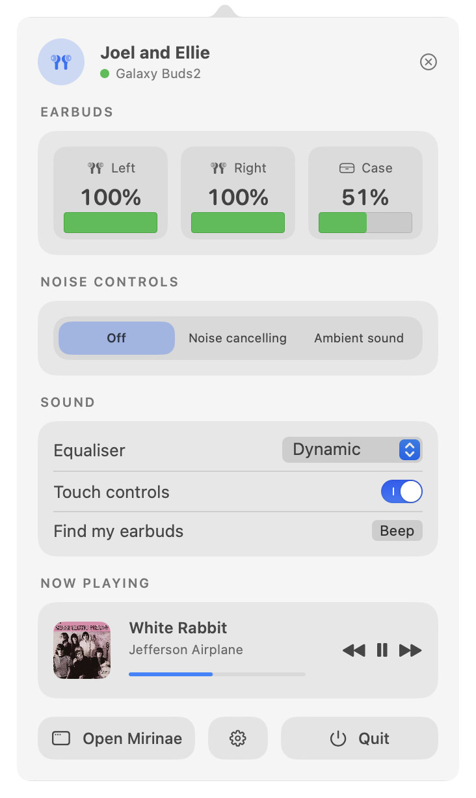
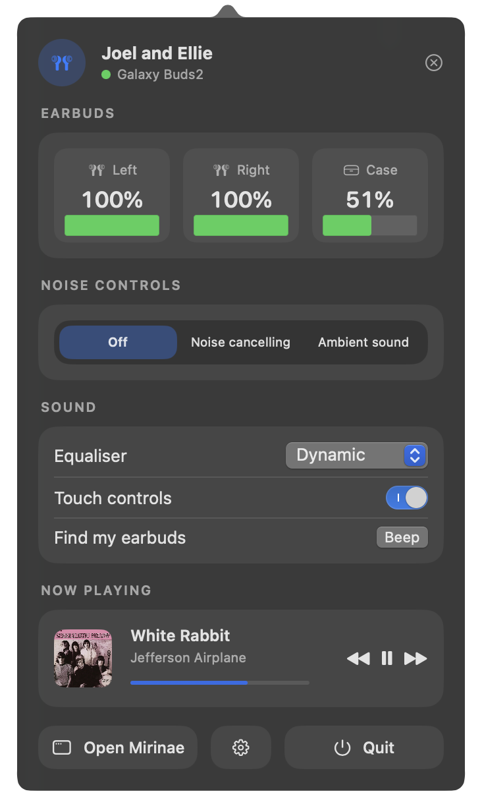
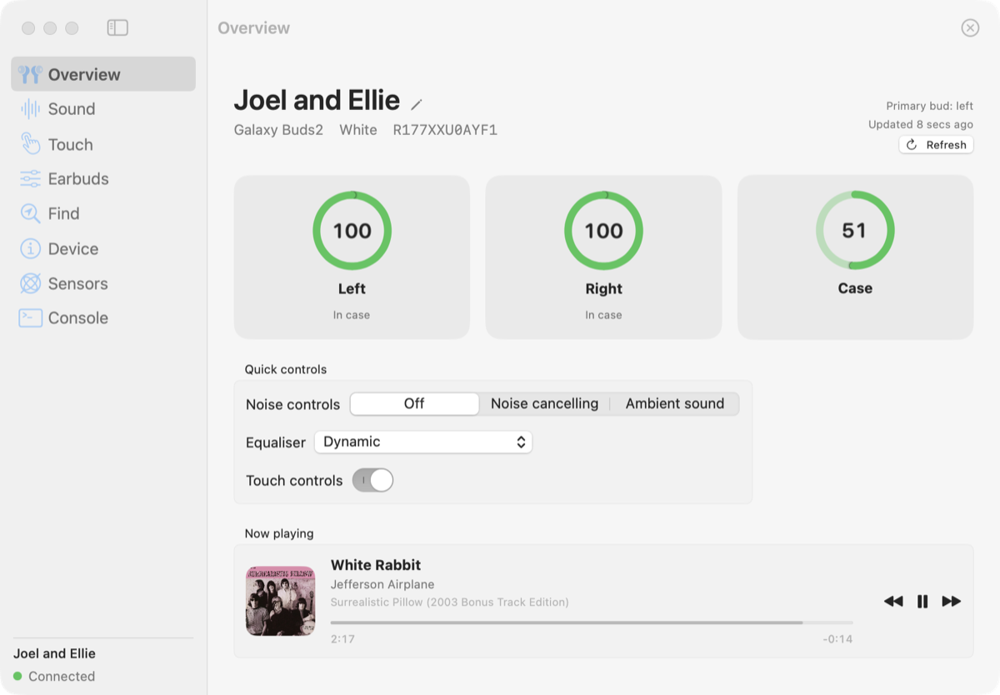

# Mirinae

Mirinae is a native macOS app for Samsung Galaxy Buds devices. "Mirinae" is the old Korean
word for the Milky Way (미리내). It talks to the earbuds directly over Bluetooth, so you get
battery levels, noise controls, touch settings, and a pile of diagnostics that Samsung only
exposes on their phones, if at all. It runs both as a normal window and as a menu bar item,
and it works without any Samsung software on your macOS device.

Mirinae is an independent project, distributed as-is as a macOS app without any additional
software. Mirinae is free and open source. It is not affiliated with, endorsed by, or
supported by Samsung Electronics Co., Ltd. Please refer to the
[Acknowledgements and legal notes](#acknowledgements-and-legal-notes) section for more. It
was written against a pair of my Galaxy Buds 2 and the protocol notes the community has put
together over the years, via reverse engineering and other means.

| Menu bar panel (light) | Menu bar panel (dark) |
| :---: | :---: |
|  |  |



More screenshots of every section (Sound, Touch, Earbuds, Find, Device, Sensors, Console,
and Settings) are in the [`docs/screenshots`](docs/screenshots) folder.

## Installation

You need macOS 14 or later, and your Galaxy Buds already paired with the Mac in System
Settings.

With [Homebrew](https://brew.sh), either of these works:

```sh
brew install agriyakhetarpal/tap/mirinae          # builds on your Mac, no Gatekeeper prompt
brew install --cask agriyakhetarpal/tap/mirinae   # prebuilt app, faster
```

Or download `Mirinae-<version>.zip` from the
[releases page](https://github.com/agriyakhetarpal/mirinae/releases), unzip it, and drag
Mirinae to your Applications folder.

Every release zip is built by GitHub Actions from the tagged commit and comes with a
[Sigstore attestation](https://docs.github.com/en/actions/concepts/security/artifact-attestations).
This is useful if you wish to check that your download is the one produced by the GitHub Actions
workflow in this repository and has not been tampered with.

To verify, run:

```sh
gh attestation verify Mirinae-<version>.zip --repo agriyakhetarpal/mirinae
```

Note that the prebuilt app is not notarised, because that needs a paid Apple developer
account. The first time you open a downloaded copy, macOS will say it cannot verify the
developer. Open System Settings → Privacy & Security, scroll down, and press "Open Anyway".
This happens only once. The Homebrew formula and a build from source skip this step
entirely, because apps built on your own Mac are never quarantined.

## First run

1. Take the earbuds out of the case. Mirinae connects on its own whenever they connect to
   your Mac.
2. macOS asks for Bluetooth permission. Allow it.
3. If Apple Music or Spotify is open, macOS also asks whether Mirinae may control that app.
   That is the Now Playing card asking what is playing. Allow it if you want the card.

The menu bar item shows the battery and opens a panel with the controls you reach for most.
The window, under the same icon, has everything else.

## What it does

- Battery for each bud and the case, wear state, and charging state, in the window and in a
  menu bar panel with the controls you reach for most!
- What Apple Music or Spotify is playing, with artwork and transport controls, next to the
  earbud status
- Noise controls (off, noise cancelling, ambient sound) with ambient volume, per-side ambient
  customisation, and tone
- A nine-band equaliser you drag with the mouse. On Buds 3 and newer, the bands go to the
  firmware as custom gains. Older models, including Buds 2, only work with presets – therefore,
  the curve snaps to the closest preset
- Left/right balance for the audio output
- Touch controls: lock the touchpad, keep individual gestures enabled while locked, choose what
  touch-and-hold does on each side, and pick which modes the noise control gesture cycles
  through on each bud
- Custom touch-and-hold actions that run a shell command on your macOS device. Samsung reserves
  this slot only for their phone app. Mirinae lets you point it at anything: pause Apple Music,
  run a Shortcut, toggle a Focus, and galore. See [docs/custom-actions.md](docs/custom-actions.md)
- Seamless connection, voice wake-up and its language, call answering, sidetone, and a
  "noise controls with one earbud" option
- "Find my earbuds" with per-side mute
- Pairing mode on demand, so you can pair a second device
- Rename the earbuds
  - Caveat: the name is stored on the buds. Devices that are already paired, including
    your macOS device, will show the old name until they pair again. This is a similar
    caveat to Samsung's own app and is defined by the firmware.
- A device page with firmware and hardware revisions, serial numbers, SKU and region code,
  cell voltages, charge and discharge current, temperature, charge cycle counts, raw
  accelerometer and proximity readings, and the firmware's own usage counters
- Earbud fit test and a hardware self test
- Firmware updates: checks a community archive of Samsung's official builds, verifies the
  image's checksums and model, and sends it to the earbuds, which flash it themselves. A
  local image file works too!
- Live head tracking from the built-in gyroscope, shown as a quaternion and a moving dot
- A console that shows every message in both directions and lets you send your own messages

Everything that a setting on your Buds needs is sent straight to the firmware, and every reply
is decoded as it arrives. If the buds push a change (say, you cycle noise controls by touching
a bud), the app updates immediately.

## Supported models

| Model                                                                       | Status                                                                                                                                                        |
| --------------------------------------------------------------------------- | ------------------------------------------------------------------------------------------------------------------------------------------------------------- |
| Galaxy Buds 2 (SM-R177)                                                     | Developed and tested on this model!                                                                                                                           |
| Buds2 Pro, Buds FE, Buds Core, Buds3, Buds3 Pro, Buds3 FE, Buds4, Buds4 Pro | Decoders have been written from published layouts, untested. [Please report any issues you encounter!](https://github.com/agriyakhetarpal/mirinae/issues/new) |
| Buds+, Buds Live, Buds Pro                                                  | Untested but should more or less work. [Please report any issues you encounter!](https://github.com/agriyakhetarpal/mirinae/issues/new)                       |
| Galaxy Buds (2019)                                                          | Framing and status decoding only, untested                                                                                                                    |

The model detection code depends upon the SKU reported by the earbuds. It falls back to the
colour code in the first status message, and finally the Bluetooth name.

If you own one of the untested models and something looks wrong, the Console section plus a
log file (see [CONTRIBUTING.md](CONTRIBUTING.md)) is usually enough to work out what differs.
If you need any assistance, please report it on the
[GitHub issues page](https://github.com/agriyakhetarpal/mirinae/issues/new) and include the
log file if possible. I will do my best to help you resolve any issues.

## Settings and tips

Settings has three switches that change how the app lives on your Mac. "Hide the Dock
icon" keeps Mirinae in the menu bar only. "Launch at login" does what it says. "Launch when
the earbuds connect" registers a small background helper (`MirinaeWatcher`, about 10 MB)
that does nothing but wait for your earbuds and start Mirinae in the background when they
connect. It shows up under Login Items → Allow in the Background, and it needs Mirinae to
stay in your Applications folder.

Custom touch-and-hold lives in the Touch section: set a side to "Custom" and enter a shell
command. It runs with `zsh -lc`, so aliases and `PATH` from your login shell apply. See
[docs/custom-actions.md](docs/custom-actions.md) for what people do with it.

Connect and Disconnect mean the Bluetooth link to the Mac, the same as the Bluetooth menu.
Disconnect drops audio too. Connect works when the earbuds are out of the case and in range
but not connected, and then opens the control channel.

The earbuds only send their full status when the control channel opens, so the Refresh
button (⌘R) reopens it. Mirinae also does this on its own, every minute by default. Settings
offers 20 seconds, 1 minute, 5 minutes, or off. A refresh costs a few milliseconds and about
a kilobyte of Bluetooth traffic, so the short interval is fine, and audio is not interrupted.
The case level is the usual victim: the buds only see the case while its lid is open or a
bud is docked, so the Overview shows the last level it saw and when.

## Troubleshooting

If a connection attempt ends with "The earbuds did not answer", the firmware is probably
still holding a session for a client that vanished without closing the channel (a crash, a
force quit, a debugger). It allows one control client at a time. Put both buds in the case,
close the lid for ten seconds, and take them out. Mirinae reconnects on its own.

If nothing happens when the earbuds connect even though "Launch when the earbuds connect"
is on, open Mirinae once by hand. It rewrites the helper's registration if the app has moved.
For a closer look, run `launchctl print gui/$(id -u)/al.agriyakhetarp.mirinae.watcher` and
check that the state is `running`.

If Now Playing stays empty, check System Settings → Privacy & Security → Automation and make
sure Mirinae may control Music or Spotify.

## Known gaps

- Firmware updates were implemented from the documented exchange and tested only as far as
  "check for updates" and the start of a transfer, on hardware that was already current. A
  full update has not been run yet. Keep the earbuds charged and close to your Mac if you
  try one, and please report how it went!
- The custom equaliser path (Buds 3 and newer) is implemented from the published message
  layout but has not been tried on real hardware
- Artwork for Apple Music streaming tracks comes from the iTunes Search API, because the
  Music app does not expose it through scripting. Local library tracks use the embedded
  artwork
- The sidetone toggle is sent correctly, but on Buds 2 the firmware did not acknowledge it
  during testing. Confirm it on a call

## Privacy

No telemetry and no automatic update checks. The only network traffic is album artwork
lookups for Now Playing and, when you ask for it, the firmware archive. Everything else stays
on your macOS device. The custom touch-and-hold command runs only text you typed yourself.
The full write-up is in [docs/security.md](docs/security.md), and [SECURITY.md](SECURITY.md)
says how to report a problem.

## Hacking on it

Mirinae is a Swift package that builds with the Xcode Command Line Tools alone. Building,
unit tests, project layout, translations, and the notes on how the protocol was worked out
are in [CONTRIBUTING.md](CONTRIBUTING.md) and under [docs/](docs/). The protocol reference,
[docs/protocol.md](docs/protocol.md), is reusable in other projects.

The code was written by steering a generative AI system (Anthropic's Claude, through Claude
Code) under my direction, with every feature tested against real earbuds as it was written.
The decisions and the review are mine. More on that in CONTRIBUTING.md. I am the sole
author and maintainer of this project, and I appreciate any contributions!

## Acknowledgements and legal notes

Mirinae stands on a lot of other people's work.

- Samsung Electronics Co., Ltd. make the earbuds, the firmware, and the Galaxy Wearable
  app. The control protocol this app speaks is theirs. My app, Mirinae, exists because
  the hardware is great and the phone app is phone-only. Thank you!
- [GalaxyBudsClient](https://github.com/timschneeb/GalaxyBudsClient) by Tim Schneeberger
  and contributors (GPL-3.0). Years of community reverse engineering of Samsung's protocol
  live there: message ids, payload layouts, the per-model quirks. Mirinae's protocol library
  was written independently from those published findings, verified against a Buds 2 device,
  and shares no code with that project.
- [Galaxy Buds firmware archive](https://github.com/timschneeb/galaxy-buds-firmware-archive)
  by Tim Schneeberger (thanks again!): the mirror of Samsung's official firmware images that
  the "Check for updates" feature queries. The images themselves are Samsung's.
- [Vorssaint](https://github.com/vorssaint/vorssaint-utils) (GPL-3.0) for the look of
  the menu bar panel: dark, calm, cards and pill buttons. No code was utilised.
- [boringNotch](https://github.com/TheBoredTeam/boring.notch) and
  [mediaremote-adapter](https://github.com/ungive/mediaremote-adapter) were studied for
  Now Playing. Mirinae took a different route (the players' own scripting interfaces), but
  the comparison is documented in `docs/development.md`
- Apple frameworks and services: SwiftUI, AppKit, IOBluetooth, Swift Testing, SF
  Symbols, and the public iTunes Search API for artwork.
- Bluetooth SIG specifications for RFCOMM and the Serial Port Profile, the transport
  underneath everything.
- The design pass used the open-source `impeccable` design skill for Claude Code as a
  checklist to evaluate the design and improve UX across the application.

Samsung, Galaxy, Galaxy Buds, Galaxy Wearable, Bixby, and SmartThings are trademarks or
registered trademarks of Samsung Electronics Co., Ltd. Apple, macOS, and Apple Music are
trademarks of Apple Inc. Spotify is a trademark of Spotify AB. These names are used only to
describe compatibility and do not imply endorsement.

Mirinae sends commands to earbud firmware that Samsung does not document for third parties.
It is offered as is, without warranty of any kind, including the implied warranties of
merchantability or fitness for a particular purpose. Please use it at your own risk.

## License

The code is under the Apache License 2.0. See [LICENSE](LICENSE) and [NOTICE](NOTICE). In
short: use, change, and redistribute freely, keep the license and notice with it, and
contributions come with a patent grant. The license grants no rights to the Samsung or Apple
trademarks mentioned above.

The documentation (`docs/`, this README, and CONTRIBUTING.md) is under the Creative
Commons Attribution 4.0 International license, see [LICENSE-DOCS](LICENSE-DOCS), so the
protocol notes can be reused in other projects with credit.
